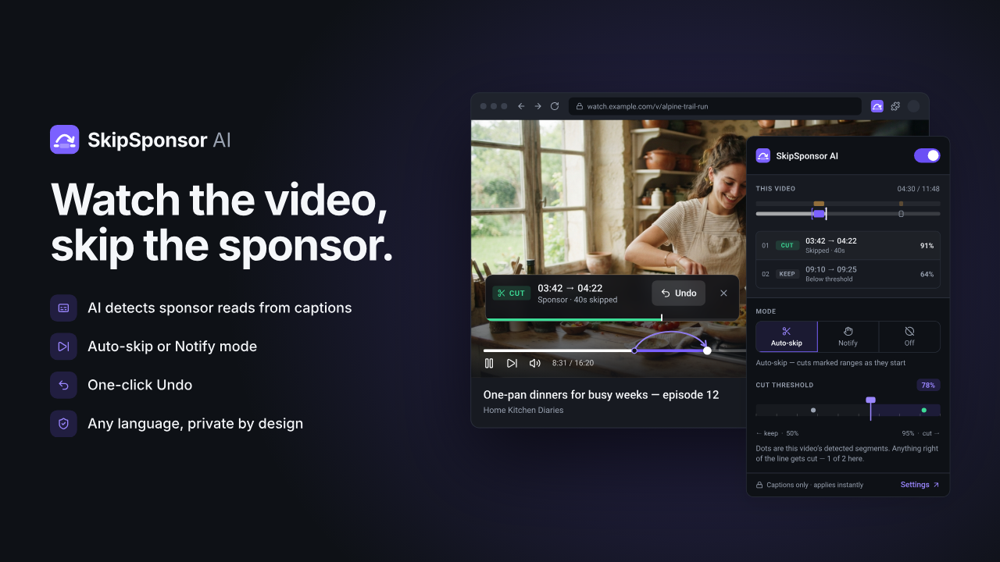
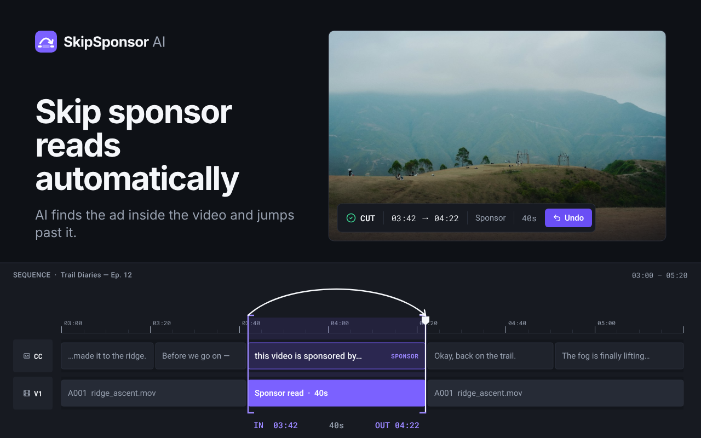
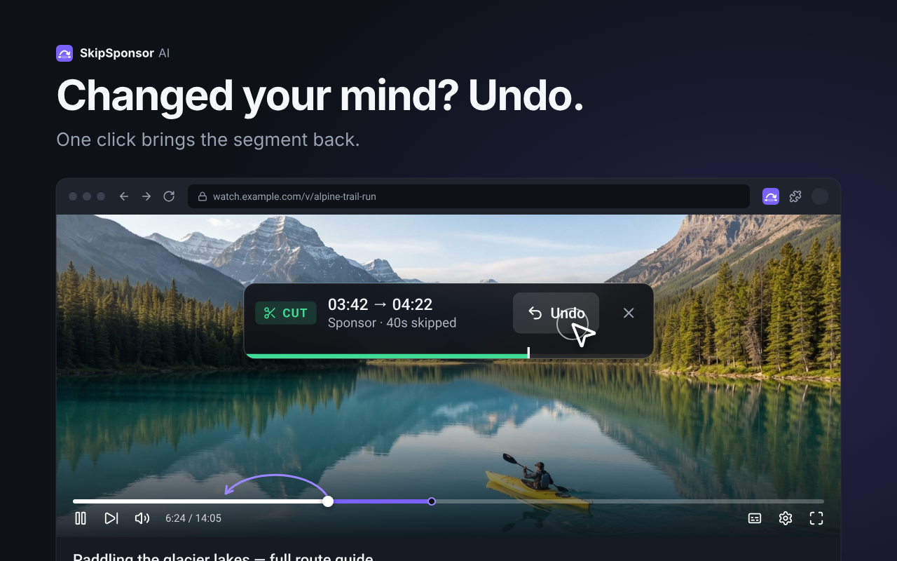
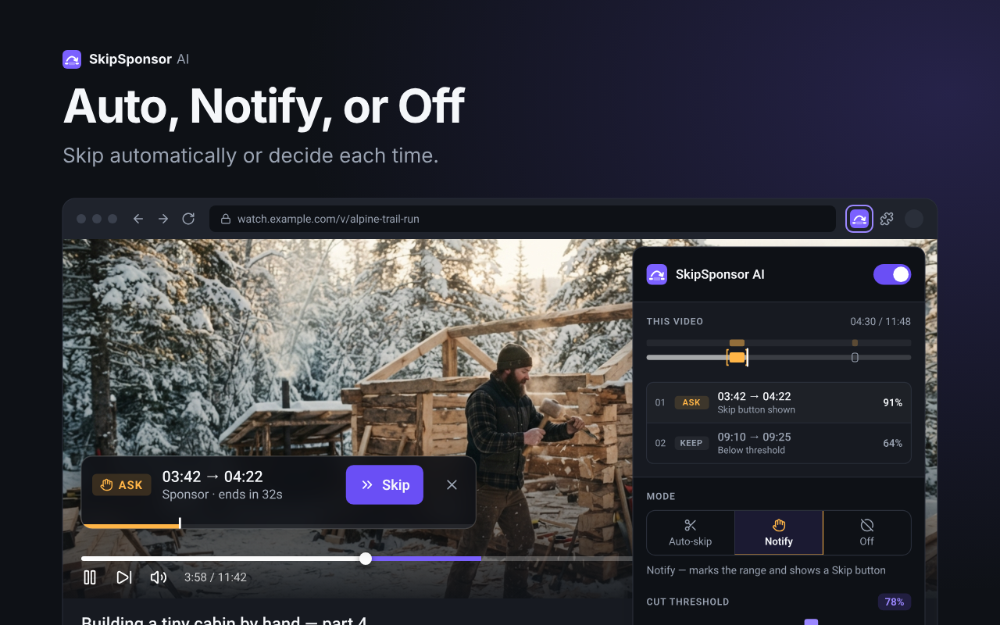
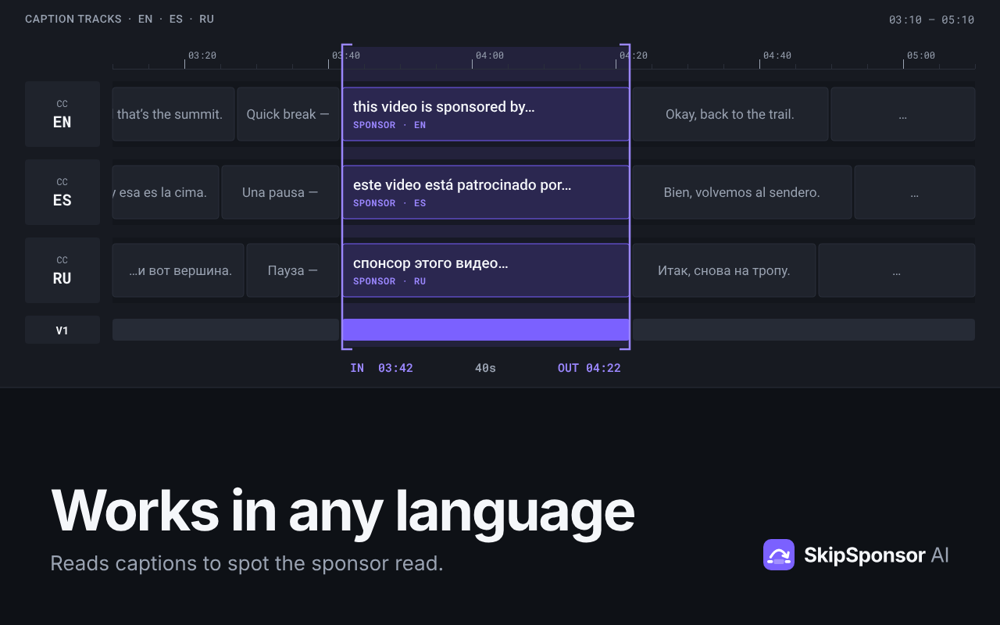
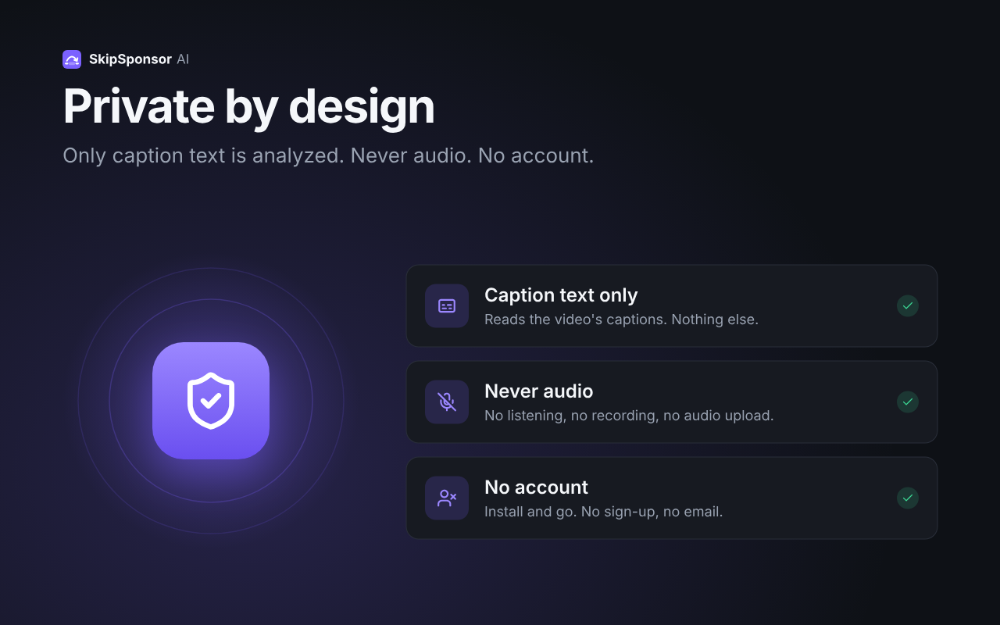

<div align="center">
  
  <h1>SkipSponsor AI</h1>
  <p><strong>Skip sponsor reads inside YouTube videos. AI reads the captions, marks the sponsor segment, and jumps past it — with one-click Undo.</strong></p>
  <p>
    <a href="./LICENSE"></a>
    <a href="https://github.com/juanjaragavi/skip-sponsor-ai/actions/workflows/ci.yml"></a>
    
    
    <a href="./CONTRIBUTING.md"></a>
  </p>
  <picture>
    <source media="(prefers-color-scheme: dark)" srcset="brand/png/lockup-horizontal-on-dark.png" />
    
  </picture>
</div>

---

**SkipSponsor AI** is an open source MV3 Chrome extension that automatically detects and skips in-video sponsor reads on YouTube using AI-powered caption analysis. Powered by Anthropic Claude, it targets ≥93% precision and ≥90% recall on a labeled evaluation set (a design target from the technical spec, not yet measured) while respecting user preferences and privacy.

- 🧠 **AI-powered** — Claude Haiku 4.5 analyzes captions; Claude Sonnet 5.5 fallback for ambiguous cases
- ⏭️ **Auto-skip with Undo** — jumps past sponsor reads, 4-second window to go back
- 🎛️ **You're in control** — Auto / Notify / Off per video, confidence threshold (50–95%), per-channel opt-out
- 🌍 **Any language** — works with auto or uploaded captions; SponsorBlock fallback when captions are missing
- 🔒 **Private by design** — caption text only (never audio), no account, 30-day result retention
- ⚡ **Fast & cheap** — p95 analysis <4.0s, skip trigger <300ms, ~$0.004/video with 65%+ cache hits

## Screenshots



| Skip automatically                                                               | Changed your mind? Undo                       | Auto, Notify, or Off                                     |
| -------------------------------------------------------------------------------- | --------------------------------------------- | -------------------------------------------------------- |
|  |  |  |

| Works in any language                                           | Private by design                                                |
| --------------------------------------------------------------- | ---------------------------------------------------------------- |
|  |  |

> All screenshots are 1280×800 Chrome Web Store assets in [`store/screenshots/`](store/screenshots/). Brand marks and lockups live in [`brand/`](brand/).

## Contents

- [Quick Start](#quick-start)
- [Environment Variables](#environment-variables)
- [Development](#development)
- [Testing & Quality](#testing--quality)
- [Deployment](#deployment)
- [Architecture](#architecture)
- [Security & Privacy](#security--privacy)
- [Troubleshooting](#troubleshooting)
- [Contributing](#contributing)
- [Code of Conduct](#code-of-conduct)
- [Security](#security)
- [License](#license)
- [Attribution](#attribution)
- [Support](#support)
- [Acknowledgments](#acknowledgments)

## Quick Start

### Prerequisites

- **Node.js:** 20 LTS
- **npm:** 8.x+
- **Chrome:** 116+
- **Docker:** for local PostgreSQL + Redis (optional, full backend setup)
- **Anthropic API Key:** sign up at [console.anthropic.com](https://console.anthropic.com)

### 1. Clone & Install

```bash
git clone https://github.com/juanjaragavi/skip-sponsor-ai.git
cd skip-sponsor-ai
npm ci
```

### 2. Environment Setup

```bash
cp .env.example .env.local
```

See [Environment Variables](#environment-variables) below for required keys.
Never commit `.env*` files — they are git-ignored.

### 3. Development Build

```bash
npm run build:extension
```

This generates `dist/extension/` for local testing.

### 4. Load Extension in Chrome

1. Open `chrome://extensions/`
2. Enable **Developer Mode** (toggle in top-right)
3. Click **Load unpacked**
4. Select `/path/to/skip-sponsor-ai/dist/extension`
5. Test on YouTube videos

### 5. Backend Setup (Optional)

For full local development with LLM inference:

```bash
docker compose -f infra/docker-compose.yml up -d
psql "$DATABASE_URL" -v ON_ERROR_STOP=1 -f infra/db/migrations/001_init.sql   # no migrate script yet
npm run dev:api
```

Backend listens on `http://localhost:3040` by default.

Local ports are unique across DevSpeak projects so several can run at once:

| Service                                | Host port | Set in                                              |
| -------------------------------------- | --------- | --------------------------------------------------- |
| API (`npm run dev:api`)                | 3040      | `package.json` `config.port` (override with `PORT`) |
| Extension dev server (`dev:extension`) | 5174      | `vite.config.ts` (`strictPort`)                     |
| Postgres (Docker)                      | 5434      | `infra/docker-compose.yml` (container port 5432)    |
| Redis (Docker)                         | 6380      | `infra/docker-compose.yml` (container port 6379)    |

The API container (`infra/Dockerfile.api`) still listens on 3000 when `PORT` is unset.

### 6. Local tunnel (share the local API)

`npm run dev:tunnel` opens a Cloudflare tunnel to `http://localhost:3040` and runs the local stack behind it: Postgres and Redis (`docker compose -f infra/docker-compose.yml up -d --wait`), `npm run db:migrate`, then `npm run dev:api` against the Docker Postgres (5434) and Redis (6380). It needs `cloudflared` (`brew install cloudflared`). Ctrl+C stops the API and the tunnel; the containers keep running (`docker compose -f infra/docker-compose.yml down` stops them, data stays in the `pgdata` volume).

- It also builds `dist/extension-tunnel/` with `VITE_API_BASE_URL=<tunnel URL>`: load it unpacked or zip it for testers. Their extension then calls your local API. Real analyses need `ANTHROPIC_API_KEY` in `.env`; without it the API serves cached and SponsorBlock results only.
- There are no inbound webhooks. Check the public URL with `curl <tunnel URL>/healthz` and `/readyz`.
- A quick tunnel gets a new `*.trycloudflare.com` URL on every run, so rebuild and re-share the extension each time, or run with `DEV_TUNNEL_NAME=<name> DEV_TUNNEL_HOSTNAME=<hostname>` for a named tunnel (`cloudflared tunnel create`, `cloudflared tunnel route dns`).
- `npm run dev:extension` (HMR on :5174) keeps targeting `http://localhost:3040`. The URL is written to `.env.tunnel.local` (gitignored, removed on exit).

Local database backups: `npm run db:dump:local` writes a `pg_dump -Fc` file to `.backups/local/` (gitignored). `npm run db:restore:local -- .backups/local/<file>.dump --yes` dumps the current state first, then restores the file in one transaction (stop the API first).

## Environment Variables

### Extension (Client-Side)

In `.env.local`, loaded at build time:

| Variable            | Required | Default                                                                     | Description                                     |
| ------------------- | -------- | --------------------------------------------------------------------------- | ----------------------------------------------- |
| `VITE_API_BASE_URL` | Yes      | none for production builds (they fail without an https URL); dev: `http://localhost:3040` | Backend API endpoint (dev) or production domain |
| `VITE_ENVIRONMENT`  | No       | `development`                                                               | `development`, `staging`, or `production`       |
| `VITE_DEBUG_MODE`   | No       | `false`                                                                     | Verbose console logging in content script       |

Only `VITE_API_BASE_URL` is read by the extension code today; the other two are placeholders.

### Backend API (Server-Side)

In `.env`, loaded at server startup:

| Variable                     | Required        | Default                                                   | Description                                                                      |
| ---------------------------- | --------------- | --------------------------------------------------------- | -------------------------------------------------------------------------------- |
| `ANTHROPIC_API_KEY`          | Yes             | —                                                         | API key from [console.anthropic.com](https://console.anthropic.com)              |
| `DATABASE_URL`               | Production      | — (in-memory store when unset)                            | PostgreSQL connection string; the shared analysis cache                          |
| `REDIS_URL`                  | No              | —                                                         | Optional hot cache in front of Postgres                                          |
| `INSTALL_TOKEN_SECRET`       | Production      | — (any opaque token accepted in dev)                      | HMAC key for anonymous install tokens (≥32 chars)                                |
| `DAILY_ANALYSES_PER_INSTALL` | No              | `25`                                                      | Fresh LLM analyses per install per UTC day; cached videos never count            |
| `LLM_DAILY_BUDGET_USD`       | No              | `2`                                                       | Global daily LLM spend cap; `0` switches the LLM off                             |
| `CORS_ORIGIN`                | No              | dev: any; production: any `chrome-extension://` origin    | Comma-separated origins, e.g. `chrome-extension://<item id>`                     |
| `TRUST_PROXY`                | Behind a proxy  | `0`                                                       | `1` = use `X-Forwarded-For` for client IPs (rate limits)                         |
| `NODE_ENV`                   | No              | `development`                                             | `production` enables the startup config checks                                   |
| `CACHE_TTL_DAYS`             | No              | `30`                                                      | Analysis retention; expired rows are hard-deleted hourly                         |
| `PORT`                       | No              | `3040` local (`npm run dev:api`), `3000` in the container | Server listen port                                                               |

Full list (pool size, migrations on start, install-token rate limit, kill switch) in [`.env.example`](.env.example) and [`docs/DEPLOY.md`](docs/DEPLOY.md). `LOG_LEVEL`, `RATE_LIMIT_*`, `LLM_TIMEOUT_MS`, `LLM_MAX_RETRIES`, `CONFIDENCE_THRESHOLD` and `SENTRY_DSN` in `.env.example` are spec placeholders that no code reads yet.

### Getting an Anthropic API Key

1. Visit [console.anthropic.com](https://console.anthropic.com)
2. Sign in or create an account
3. Navigate to **API Keys**
4. Create a new key and set `ANTHROPIC_API_KEY=sk-ant-...` in `.env`
5. **Never commit `.env` to git**

## Development

```bash
npm run typecheck          # tsc --noEmit (strict)
npm run lint               # ESLint
npm run lint -- --fix      # auto-fix
npm run format             # Prettier

npm run test               # Vitest, all tests
npm run test:watch         # watch mode
npm run test:coverage      # coverage report (80% gate)
npm run test:e2e           # Playwright E2E

npm run build:extension    # bundle MV3 extension
npm run build:api          # build backend
npm run dev:extension      # Vite HMR + CRXJS on :5174
npm run dev:api            # Fastify dev server on :3040
npm run verify             # lint + typecheck + test

# Database: no migrate/seed scripts yet; apply SQL directly
psql "$DATABASE_URL" -v ON_ERROR_STOP=1 -f infra/db/migrations/001_init.sql
```

### Project Structure

```
src/
├── extension/              # Chrome MV3 extension
│   ├── content-script.ts  # detector + skipper
│   ├── service-worker.ts  # API calls, in-flight dedupe, install token
│   ├── policy.ts          # decideSkip() policy engine
│   ├── toast.ts           # Shadow DOM UI
│   ├── popup.* / options.* # toolbar popup and options page
│   └── manifest.json
├── api/                    # Fastify backend
│   ├── routes/            # API endpoints
│   ├── services/          # business logic (LLM, chunking, SponsorBlock)
│   ├── repositories/      # Postgres + optional Redis; in-memory for dev/tests
│   ├── config.ts          # config loader
│   └── server.ts          # Fastify setup
├── shared/                 # shared types, Zod validators, constants
├── types/                  # ambient declarations (opossum)
└── tests/                  # unit (Vitest) and e2e (Playwright)
```

## Testing & Quality

```bash
npm run test -- --run   # unit: mergeSegments(), thresholdFilter(), decideSkip(), route validation
npm run test:e2e        # loads extension, plays fixture videos, asserts skip + undo
```

Minimum **80% coverage** enforced in CI (lines, branches, functions).

## Deployment

### Chrome Web Store

```bash
echo "VITE_API_BASE_URL=https://api.<your-domain>" > .env.production   # gitignored
npm run package:extension   # → release/skipsponsor-ai-<version>.zip, after store checks
```

Upload the `.zip` at [chromewebstore.google.com/devconsole](https://chromewebstore.google.com/devconsole).
Full listing copy, assets, and privacy answers live in [`store/listing.md`](store/listing.md).

### Backend

One container (`infra/Dockerfile.api`) plus PostgreSQL, hosted on InstaCloud
([ADR 0001](docs/adr/0001-api-hosting-instacloud.md)). The live project and its
start, stop and redeploy commands are in
[`docs/runbooks/deploy-instacloud.md`](docs/runbooks/deploy-instacloud.md).
[`docs/DEPLOY.md`](docs/DEPLOY.md) also covers an Oracle Cloud Always Free VM
(`infra/oracle/`) as a fallback. The AWS Terraform in `infra/terraform` is
**superseded** and was never applied.

```bash
npm run build:api      # → dist/api/server.mjs + dist/api/migrate.mjs
npm run db:migrate     # apply infra/db/migrations to DATABASE_URL
npm run stage:api      # → dist/deploy-api/, a build context with the Dockerfile at its root
```

### Local Testing Guide

See [`docs/LOCAL_TESTING.md`](docs/LOCAL_TESTING.md) for PostgreSQL + Redis setup,
backend logs, loading the extension, and DevTools debugging.

## Architecture

Full details: [`skip-sponsor-ai-technical-spec.md`](skip-sponsor-ai-technical-spec.md).

1. Content script captures captions from the YouTube video
2. Sends `videoId` to the service worker
3. Service worker queries the backend API
4. Backend checks cache; on miss, classifies with Claude
5. Segments returned; content script seeks past sponsor reads
6. Toast shows an Undo option within 4 seconds

## Security & Privacy

- **Zero audio upload:** transcript text only
- **30-day retention:** automatic hard delete after TTL
- **No tracking:** no cross-site tracking or profiling
- **Install tokens:** opaque 256-bit auth per browser profile
- **GDPR/CCPA compliant:** data-subject delete via API
- **DPA:** zero-retention inference flag with Anthropic

See [`PRIVACY.md`](PRIVACY.md) and the technical spec §6 for complete controls.
To report a vulnerability, see [Security](#security) below — do not open public issues.

## Troubleshooting

### Extension doesn't detect sponsors

1. Check the video has captions (auto or manual)
2. Verify `VITE_API_BASE_URL` points to a running backend
3. Check `chrome://extensions/` → Details → Errors
4. Enable `VITE_DEBUG_MODE=true` for verbose logging

### Backend API errors

1. Verify `ANTHROPIC_API_KEY` is set and valid
2. Check PostgreSQL + Redis: `docker-compose ps`
3. Review logs: `npm run dev:api`
4. Check rate limiting: default 60 req/min/install

### LLM timeouts

- Increase `LLM_TIMEOUT_MS` (default 8000ms)
- Check [status.anthropic.com](https://status.anthropic.com)
- Review backend logs for `llm_timeout` events

## Contributing

Contributions are welcome under the [MIT License](LICENSE) (inbound = outbound).

1. Fork and branch: `git checkout -b feature/my-feature`
2. Implement with tests; run `npm run verify`
3. Sign off commits (`git commit -s`) per the Developer Certificate of Origin
4. Open a PR with a test plan using the template

Please read **[CONTRIBUTING.md](CONTRIBUTING.md)** for setup, Conventional Commits,
quality gates, and review process, and follow the **[Code of Conduct](CODE_OF_CONDUCT.md)**.
Report bugs with the [bug template](.github/ISSUE_TEMPLATE/bug_report.md) and propose
features with the [feature template](.github/ISSUE_TEMPLATE/feature_request.md).

## Code of Conduct

This project follows the [Contributor Covenant v2.1](CODE_OF_CONDUCT.md).
Be kind, be respectful, assume good faith. Report violations via a
[private security advisory](https://github.com/juanjaragavi/skip-sponsor-ai/security/advisories/new).

## Security

Only the latest `1.x` release is supported. **Do not report vulnerabilities in
public issues** — see [SECURITY.md](SECURITY.md) for private reporting,
scope, safe harbor, and response timelines.

## License

MIT © 2026 Juan Jaramillo — see [LICENSE](LICENSE) for the full text.

SPDX: `MIT`. The SkipSponsor AI name and logos are project trademarks;
the MIT License covers code, not trademark rights (see [Attribution](#attribution)).

## Attribution

Third-party packages, fonts, services, and data sources are credited in
**[ATTRIBUTION.md](ATTRIBUTION.md)** — including Anthropic Claude, SponsorBlock
(CC BY-NC-SA 4.0 data), YouTube (independent project, no affiliation),
Roboto (OFL-1.1), and Lucide (ISC). If you vendor new third-party code,
document it there.

## Support

- **Issues:** [GitHub Issues](https://github.com/juanjaragavi/skip-sponsor-ai/issues)
- **Discussions:** [GitHub Discussions](https://github.com/juanjaragavi/skip-sponsor-ai/discussions)
- **Security:** [SECURITY.md](SECURITY.md) for private vulnerability reporting
- **Privacy:** [PRIVACY.md](PRIVACY.md)

## Acknowledgments

- Built with [Anthropic Claude](https://www.anthropic.com)
- [SponsorBlock](https://sponsorblock.org) fallback integration
- YouTube caption API
- Chrome Web Store review team
