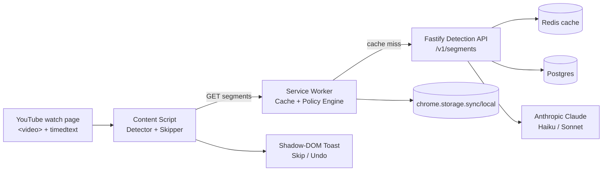
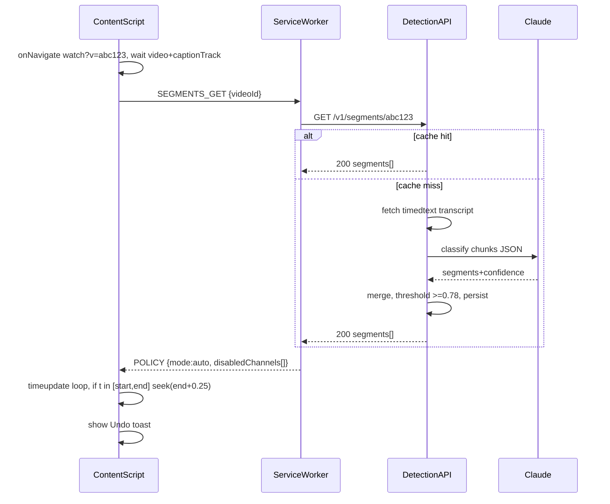

# Technical Specification: SkipSponsor AI — Claude-Powered YouTube Sponsor Skip Chrome Extension

## 1. Executive Summary & Core Requirements

### 1.1 Objective

MV3 Chrome extension that detects in-video sponsor reads by presenter/narrator on YouTube `watch` pages and auto-seeks past them. Detection via caption-transcript semantic analysis using Anthropic Claude. Client performs monitoring/seeking; server performs LLM inference.

### 1.2 Scope

**In-scope:** `youtube.com/watch` video detection, caption acquisition, sponsor segment inference, auto-skip with undo, manual mark, enable/disable per-channel, settings UI.
**Out-of-scope:** Non-YouTube sites, Shorts/Live-premiere live edge, ad-block of YouTube platform ads (pre-roll/mid-roll served by YouTube), offline inference, mobile browsers.

### 1.3 Assumptions

- A1: Desktop Chrome 116+ MV3 only. English (`en`, `en-US`, `en-GB`) at launch; other locales best-effort.
- A2: Sponsor reads are verbal and present in caption tracks (auto or manual). Pure visual overlay without speech is not detected in v1.
- A3: All Claude calls server-side via proxy. No API keys in client.
- A4: Auto-skip default ON with 4s undo toast. User seek within sponsor segment cancels auto-skip for that segment.
- A5: Cache-first: if `videoId` analyzed within 30 days, reuse segments without LLM re-call.
- A6: No PII stored. Only `videoId`, `channelId`, segment timestamps.

### 1.4 Functional Requirements

| ID    | Requirement                                                                    | Acceptance                                                       |
| ----- | ------------------------------------------------------------------------------ | ---------------------------------------------------------------- |
| FR-01 | Activate only on `watch?v=` with `<video>` + captions                          | Precision of activation = 100% on non-watch pages (no injection) |
| FR-02 | Acquire transcript with word-level timestamps                                  | Segments resolved to ±1.5s of ground truth on eval set           |
| FR-03 | Classify sponsor vs content via Claude                                         | Precision ≥93%, Recall ≥90% on 500-video labeled set             |
| FR-04 | Auto-seek `currentTime` to `endTime+0.25s` on entering segment                 | Skip latency p95 <300ms from `timeupdate` trigger                |
| FR-05 | Toast with Undo + Show skipped                                                 | Undo restores `startTime-1.0s` within 100ms                      |
| FR-06 | Per-channel allowlist/blocklist, global on/off, skip mode (auto/manual-notify) | Settings propagate <500ms, persist across restarts               |
| FR-07 | Fallback: SponsorBlock public API read-only if no captions or LLM failure      | Fallback coverage logged; no write to SponsorBlock in v1         |

### 1.5 Non-Functional Requirements

| Category                                                  | Quantitative Target                                       |
| --------------------------------------------------------- | --------------------------------------------------------- |
| End-to-end analysis (captions available → segments ready) | p95 <4.0s, p50 <1.8s                                      |
| Skip trigger latency                                      | p95 <300ms                                                |
| Client overhead idle / active                             | CPU <2% / <5%, memory <80MB                               |
| Backend availability                                      | 99.9% monthly; LLM timeout 8s with 1 retry                |
| Cost                                                      | ≤$0.004/video analysis via Haiku + cache hit rate ≥65%    |
| Privacy                                                   | Zero audio upload; transcript text only; 30-day retention |

## 2. Concrete Tech Stack & Justifications

| Layer            | Choice                                                                              | Version     | Justification                                                                                                                  |
| ---------------- | ----------------------------------------------------------------------------------- | ----------- | ------------------------------------------------------------------------------------------------------------------------------ |
| Extension client | TypeScript 5.5 + Chrome MV3, Vite 5 + CRXJS                                         | TS 5.5      | Type safety for DOM/video events; Vite HMR + MV3 bundling; CRXJS handles manifest/service-worker split correctly               |
| Content/UI       | No framework, vanilla TS + Shadow DOM for toast                                     | —           | Eliminates CSP/YouTube CSS collisions; bundle <250KB; no React runtime overhead on every watch page                            |
| Background       | MV3 Service Worker (event-driven)                                                   | MV3         | Mandatory for Chrome Web Store; non-persistent forces stateless design + `chrome.storage` persistence                          |
| Backend API      | Node.js 20 LTS + Fastify 4 + Zod                                                    | Node 20     | Fastify p95 overhead <8ms vs Express ~25ms; Zod enforces contract validation at runtime; single language with client           |
| LLM              | Anthropic Claude 3.5 Haiku (`claude-3-5-haiku-latest`) primary, Sonnet 3.5 fallback | API 2024-06 | Haiku: ~0.8s median classification at 1/5 cost; Sonnet only when confidence 0.55-0.75. Deterministic `temperature:0` JSON mode |
| Persistence      | PostgreSQL 16                                                                       | 16.3        | Relational integrity for `videoId→segments`; GIN index on metadata; ACID for cache correctness                                 |
| Cache            | Redis 7 (ElastiCache / Memorystore)                                                 | 7.2         | TTL-based `videoId` cache; reduces LLM calls by 65%+; <5ms lookup p95                                                          |
| Infra            | Docker 24, Terraform 1.9, AWS ECS Fargate + ALB, RDS Postgres, ElastiCache          | —           | Fargate removes node management; ALB handles scale-to-zero to 4 tasks; Terraform reproducibility                               |
| CI/CD            | GitHub Actions + ESLint + Prettier + Vitest + Playwright                            | —           | Automated MV3 e2e against real YouTube test fixture; artifact is versioned `.zip` for Web Store                                |
| Telemetry        | OpenTelemetry + Prometheus + Grafana, Sentry                                        | —           | OTel traces `videoId→fetch→LLM→cache`; Sentry for content-script exceptions; no user-identifiable data                         |

Trade-off log: Server-side LLM vs on-device (e.g., Transformers.js): on-device avoids backend cost but fails accuracy target (<80% small-model precision) and exceeds 80MB memory budget. Chose server proxy.

## 3. System Architecture & Design Patterns

### 3.1 Component Topology





### 3.2 Design Patterns

| Pattern             | Application                                                                                                                                   |
| ------------------- | --------------------------------------------------------------------------------------------------------------------------------------------- |
| Observer            | `MutationObserver` for SPA navigation (`yt-navigate-finish`), `timeupdate` subscriber for skip check                                          |
| Strategy            | `IDetectionProvider`: `ClaudeProvider` → `SponsorBlockFallbackProvider` → `NullProvider` (manual captions absent)                             |
| Circuit Breaker     | `opossum` around Anthropic + SponsorBlock; open after 50% failure/10 reqs, half-open 30s; serve stale cache when open                         |
| Repository          | `SegmentRepository` abstracts Postgres/Redis; client never issues SQL                                                                         |
| Policy Engine       | Centralized skip decision: `globalEnabled && !channelBlocked && confidence>=threshold && !userInSegmentOverride`                              |
| Debounce + Coalesce | Transcript fetch debounced 800ms post-`loadedmetadata`; concurrent tabs for same `videoId` coalesced to single backend call via in-flight map |

### 3.3 Key Flows & Failure Modes

| Failure                       | Handling                                                                                        |
| ----------------------------- | ----------------------------------------------------------------------------------------------- |
| No caption track              | Attempt `timedtext?v=...&kind=asr`; if 404, use SponsorBlock fallback; else mark `UNANALYZABLE` |
| LLM timeout (>8s)             | 1 retry with Haiku; then Sonnet escalation only if ambiguous; else fallback + `status:degraded` |
| User seeks back into sponsor  | Suppress re-skip for that `segmentId` for session (override flag)                               |
| SPA navigation without reload | Teardown observers, clear in-memory segments, re-init on new `videoId`                          |

## 4. Data Model & Schema Specifications

### 4.1 Domain Types

```typescript
type SkipMode = "auto" | "notify" | "off";
type SegmentSource =
  | "claude-haiku"
  | "claude-sonnet"
  | "sponsorblock"
  | "manual";
type SegmentCategory =
  | "sponsor"
  | "intro"
  | "outro"
  | "selfpromo"
  | "interaction_reminder";

interface SponsorSegment {
  id: string; // uuidv7
  videoId: string; // 11-char YouTube ID
  channelId: string | null;
  startTime: number; // seconds, >=0, 3-decimal
  endTime: number; // > startTime, maxGap 600s
  confidence: number; // 0..1
  category: SegmentCategory;
  source: SegmentSource;
  createdAt: string; // ISO8601
}

interface VideoAnalysis {
  videoId: string;
  duration: number;
  language: string; // BCP47
  status: "ready" | "pending" | "unanalyzable" | "degraded";
  segments: SponsorSegment[];
  transcriptVersion: string; // hash of timedtext
  analyzedAt: string;
}

interface UserPolicy {
  globalEnabled: boolean;
  mode: SkipMode;
  confidenceThreshold: number; // default 0.78, range 0.5-0.95
  blockedChannels: string[];
  allowlistedChannels: string[];
}
```

### 4.2 PostgreSQL Schema

```sql
CREATE TABLE video_analyses (
  video_id      TEXT PRIMARY KEY CHECK (char_length(video_id) = 11),
  channel_id    TEXT,
  duration_sec  REAL NOT NULL CHECK (duration_sec > 0),
  language      TEXT NOT NULL DEFAULT 'en',
  status        TEXT NOT NULL CHECK (status IN ('ready','pending','unanalyzable','degraded')),
  transcript_hash TEXT NOT NULL,
  analyzed_at   TIMESTAMPTZ NOT NULL DEFAULT now(),
  expires_at    TIMESTAMPTZ NOT NULL DEFAULT now() + INTERVAL '30 days'
);
CREATE INDEX idx_video_expires ON video_analyses (expires_at);
CREATE INDEX idx_video_channel ON video_analyses (channel_id);

CREATE TABLE sponsor_segments (
  id          UUID PRIMARY KEY DEFAULT gen_random_uuid(),
  video_id    TEXT NOT NULL REFERENCES video_analyses(video_id) ON DELETE CASCADE,
  start_time  DOUBLE PRECISION NOT NULL CHECK (start_time >= 0),
  end_time    DOUBLE PRECISION NOT NULL CHECK (end_time > start_time),
  confidence  REAL NOT NULL CHECK (confidence BETWEEN 0 AND 1),
  category    TEXT NOT NULL CHECK (category IN ('sponsor','intro','outro','selfpromo','interaction_reminder')),
  source      TEXT NOT NULL,
  created_at  TIMESTAMPTZ NOT NULL DEFAULT now(),
  CONSTRAINT chk_duration CHECK (end_time - start_time BETWEEN 5 AND 600),
  EXCLUDE USING gist (video_id WITH =, numrange(start_time, end_time) WITH &&)
);
CREATE INDEX idx_seg_video ON sponsor_segments (video_id, start_time);

CREATE TABLE telemetry_events (
  id UUID PRIMARY KEY DEFAULT gen_random_uuid(),
  video_id TEXT NOT NULL,
  event_type TEXT NOT NULL CHECK (event_type IN ('skip_executed','skip_undone','fallback_used','llm_error','no_captions')),
  latency_ms INT,
  created_at TIMESTAMPTZ NOT NULL DEFAULT now()
);
```

Redis keys: `seg:{videoId}` → JSON `VideoAnalysis` TTL 30d; `inflight:{videoId}` TTL 15s; `policy:{installIdHash}` not stored server-side (client `chrome.storage` only).

## 5. API Endpoints & Payload Contracts

Base: `https://api.skipsponsor.example.com/v1`. Auth: `Authorization: Bearer <install-token>` (opaque, rotated) + `x-extension-version`. Rate limit: 60 req/min/install, 500/min/IP. Errors: RFC7807 `application/problem+json`.

```json
{
  "type": "https://api.skipsponsor.example.com/problems/rate-limited",
  "title": "Rate Limited",
  "status": 429,
  "detail": "Quota exceeded, retry after 12s",
  "instance": "/v1/segments/dQw4w9WgXcQ"
}
```

### 5.1 Get segments

```http
GET /v1/segments/{videoId}
```

```json
// 200 OK - cache hit or fresh analysis
{
  "videoId": "dQw4w9WgXcQ",
  "status": "ready",
  "duration": 742.5,
  "language": "en",
  "segments": [
    {
      "id": "0191a2b3-4c5d-7e8f-90ab-cdef12345678",
      "videoId": "dQw4w9WgXcQ",
      "channelId": "UC_x5XG1OV2P6uZZ5FSM9Ttw",
      "startTime": 121.4,
      "endTime": 183.9,
      "confidence": 0.94,
      "category": "sponsor",
      "source": "claude-haiku",
      "createdAt": "2026-10-07T00:00:00Z"
    }
  ],
  "analyzedAt": "2026-10-07T00:00:05Z"
}
```

### 5.2 Trigger analysis (cache miss / force)

```http
POST /v1/segments:analyze
Content-Type: application/json
```

```json
// Request
{
  "videoId": "dQw4w9WgXcQ",
  "channelId": "UC_x5XG1OV2P6uZZ5FSM9Ttw",
  "force": false,
  "languageHint": "en"
}
```

```json
// 202 Accepted
{ "videoId": "dQw4w9WgXcQ", "status": "pending", "pollAfterMs": 1500 }
```

### 5.3 Report telemetry / manual correction

```http
POST /v1/telemetry
POST /v1/segments/{videoId}/corrections
```

```json
// POST /v1/telemetry
{ "videoId": "dQw4w9WgXcQ", "eventType": "skip_executed", "latencyMs": 142 }
// 204 No Content

// POST corrections
{ "startTime": 120.0, "endTime": 184.5, "category": "sponsor", "action": "confirm" }
// 201 Created
{ "id": "0191a2b3-4c5d-7e8f-90ab-cdef12345678", "status": "accepted" }
```

### 5.4 LLM Internal Prompt Contract (server-only)

```typescript
const SYSTEM_PROMPT = `You are a sponsor-segment classifier. Input: transcript chunks [{t0,t1,text}]. Output ONLY JSON: {segments:[{start,end,category,confidence,rationale}]}. Rules: sponsor=self-paid promotion distinct from video topic (VPN, meal kit, etc.); exclude editorial product review. Merge gaps <4s. Confidence 0-1. temperature=0.`;
interface LlmChunk {
  t0: number;
  t1: number;
  text: string;
}
const MODEL_POLICY = {
  primary: "claude-3-5-haiku-latest",
  fallback: "claude-3-5-sonnet-latest",
  timeoutMs: 8000,
  maxTokens: 1024,
  acceptThreshold: 0.78,
  reviewBand: [0.55, 0.78],
} as const;
```

Caption acquisition (server): `GET https://www.youtube.com/api/timedtext?v={videoId}&caps=asr&fmt=json3` with rotating UA; parse `events[].tStartMs/dDurationMs/segs[].utf8`. Chunk to 60s windows with 10s overlap before LLM call.

## 6. Security & Compliance Rules

| Control           | Rule                                                                                                                                                                                                                                                                                                                                             |
| ----------------- | ------------------------------------------------------------------------------------------------------------------------------------------------------------------------------------------------------------------------------------------------------------------------------------------------------------------------------------------------ |
| Secrets           | Zero secrets in extension bundle. Anthropic key in AWS Secrets Manager, injected as env at ECS runtime only. `git-secrets` + GitHub secret scanning block commits matching `sk-ant-*`.                                                                                                                                                           |
| AuthN/AuthZ       | Install-token (256-bit random, stored `chrome.storage.local`) issued at install via `POST /v1/installs`; no Google OAuth in v1. Backend validates token + origin. Admin endpoints require OIDC (Google) + RBAC `admin` role.                                                                                                                     |
| Transport/Data    | TLS 1.2+ everywhere; HSTS; Postgres encryption-at-rest (RDS AES-256); Redis TLS + AUTH; transcript cache encrypted, 30-day TTL then hard delete.                                                                                                                                                                                                 |
| Client isolation  | Content script in `ISOLATED` world; toast in Shadow DOM + `all:initial`; CSP: `script-src 'self'`; no `eval`, no remote code; `host_permissions: ["*://*.youtube.com/*"]` only; `permissions: ["storage","alarms"]`.                                                                                                                             |
| Input validation  | Zod schemas on all API inputs: `videoId` regex `^[A-Za-z0-9_-]{11}$`; timestamps finite, `end>start`; reject >600s segments. Content script sanitizes caption HTML via `textContent` only.                                                                                                                                                       |
| OWASP mitigations | A01: least-privilege permissions; A03: parameterized queries (Drizzle ORM); A07: rate-limit + circuit breaker; A09: Dependabot + `npm audit` gate; A10: SSRF allowlist — server fetches only `*.youtube.com/api/timedtext*` + `sponsor.ajay.app`.                                                                                                |
| Privacy-by-Design | No audio/video upload, no watch-history profiling, no cross-site tracking. Telemetry: `videoId` + event + latency only, no IP retention >7d (ALB logs redacted). GDPR/CCPA: data-subject delete via `DELETE /v1/segments/{videoId}` + opt-out disables all network calls except update check. DPA with Anthropic: zero-retention inference flag. |
| Abuse             | Extension must not violate YouTube ToS automation limits: max 1 transcript fetch per `videoId` per 24h per install; respect 429 with exponential backoff (1s,2s,4s). No credential harvesting; static review checklist in CI.                                                                                                                    |

```json
// manifest.json (excerpt)
{
  "manifest_version": 3,
  "name": "SkipSponsor AI",
  "version": "1.0.0",
  "permissions": ["storage", "alarms"],
  "host_permissions": ["*://*.youtube.com/*"],
  "background": { "service_worker": "sw.js" },
  "content_scripts": [
    {
      "matches": ["*://*.youtube.com/watch*"],
      "js": ["content.js"],
      "run_at": "document_idle"
    }
  ],
  "content_security_policy": {
    "extension_pages": "script-src 'self'; object-src 'self'"
  }
}
```

## 7. Coding Standards, Testing, & Observability

### 7.1 Coding Standards

- TypeScript `strict:true`, `noUncheckedIndexedAccess`, ESLint `airbnb+unicorn`, Prettier 2-space, import order enforced. No `any` without `// eslint-disable + justification`.
- Content script: no framework imports >50KB; functions pure where possible (`isInSegment(t,segs)`, `mergeSegments()` unit-testable); video access behind `VideoAdapter` interface for Playwright stubbing.
- Backend: Fastify route → Zod validator → service → repository; no direct `pg` in routes. All LLM I/O through `LlmClient` with timeout + breaker. Structured logs (pino JSON): `{reqId, videoId, latencyMs, model, confidence}`.
- Config via `config.ts` + env; example:

```yaml
# .github/workflows/ci.yml (excerpt)
name: ci
on: [push, pull_request]
jobs:
  verify:
    runs-on: ubuntu-latest
    steps:
      - uses: actions/checkout@v4
      - uses: actions/setup-node@v4
        with: { node-version: 20 }
      - run: npm ci
      - run: npm run lint && npm run typecheck
      - run: npm run test -- --coverage --coverageThreshold='{"global":{"branches":80,"functions":80,"lines":80}}'
      - run: npm run build:extension && npm run test:e2e
```

### 7.2 Testing

| Level                             | Standard                                                                                           | Gate                                                        |
| --------------------------------- | -------------------------------------------------------------------------------------------------- | ----------------------------------------------------------- |
| Unit (Vitest)                     | `mergeSegments`, `thresholdFilter`, `transcriptChunker`, `policyEngine`                            | ≥80% lines/branches, mutation spot-check                    |
| Contract (Pact/Schemathesis)      | All `/v1/*` request/response vs Zod schemas; LLM mock returns fixed JSON                           | CI fail on schema drift                                     |
| E2E (Playwright +Fixture YT page) | Load extension, play 3 fixture videos (pre-roll sponsor, mid-roll, no sponsor), assert seek + undo | Skip precision/recall gate; video fixture hashed            |
| Eval (offline)                    | 500-video labeled set, nightly Haiku vs Sonnet A/B                                                 | Promote model only if precision ≥93% and cost/video ≤$0.004 |
| Manual QA                         | Per-channel off, notify-mode banner, no-captions fallback                                          | Checklist signed per release                                |

### 7.3 Observability

- Metrics (Prometheus): `analysis_latency_ms_histogram`, `skip_trigger_latency_ms`, `llm_cost_per_video`, `cache_hit_ratio`, `fallback_rate`, `undo_rate`. Alerts: `p95_analysis>4s 5m`, `llm_error_rate>5% 10m`, `cache_hit<50% 1h`.
- Tracing: OTel `traceId` from SW → API → Claude; sampled 10%.
- Logging: pino → CloudWatch; no transcript full-text at `info` (debug only, redacted after 7d). Sentry DSN in SW + content script; `beforeSend` strips URLs to `videoId` only.
- Release: Semantic versioning, staged rollout 5%→50%→100% via Web Store; kill-switch `GET /v1/config` flag `globalKill` disables auto-skip in <5min without extension update.
